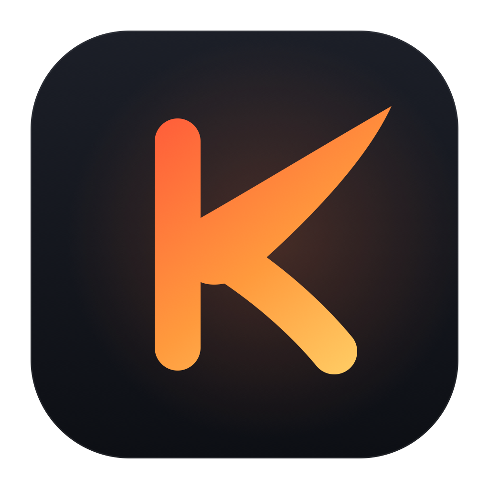
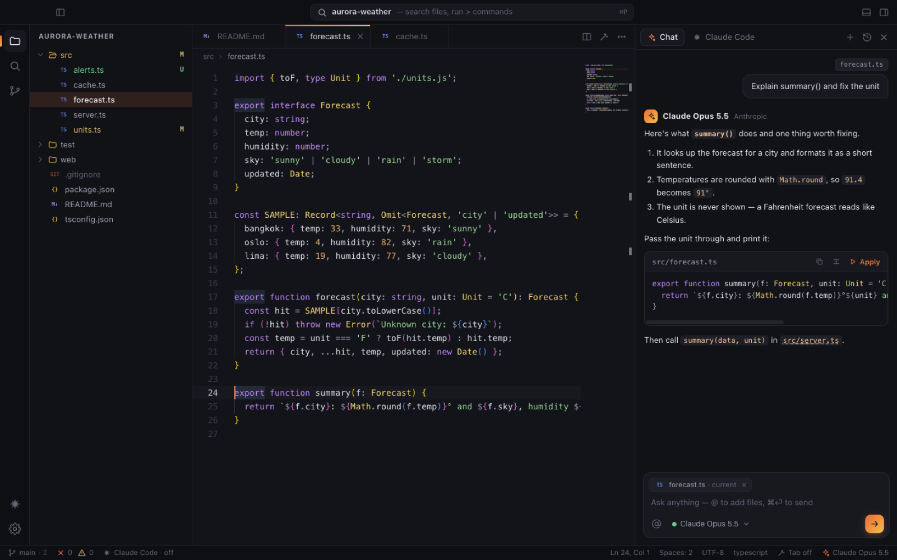
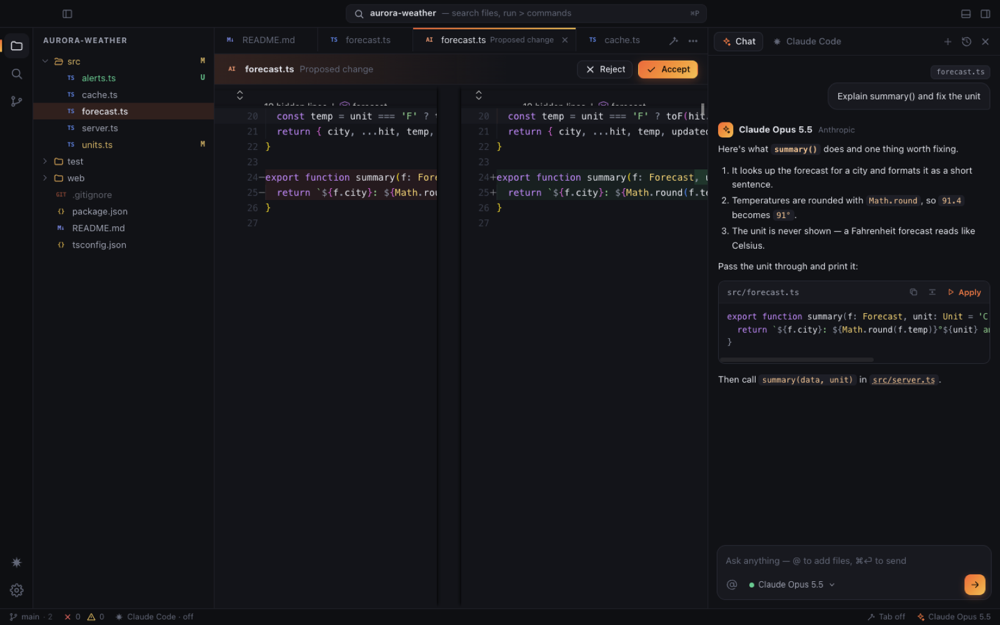
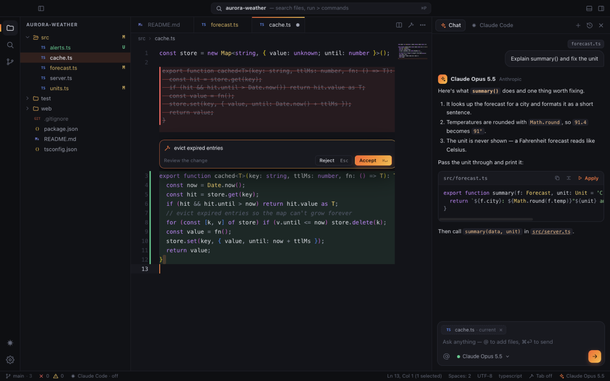
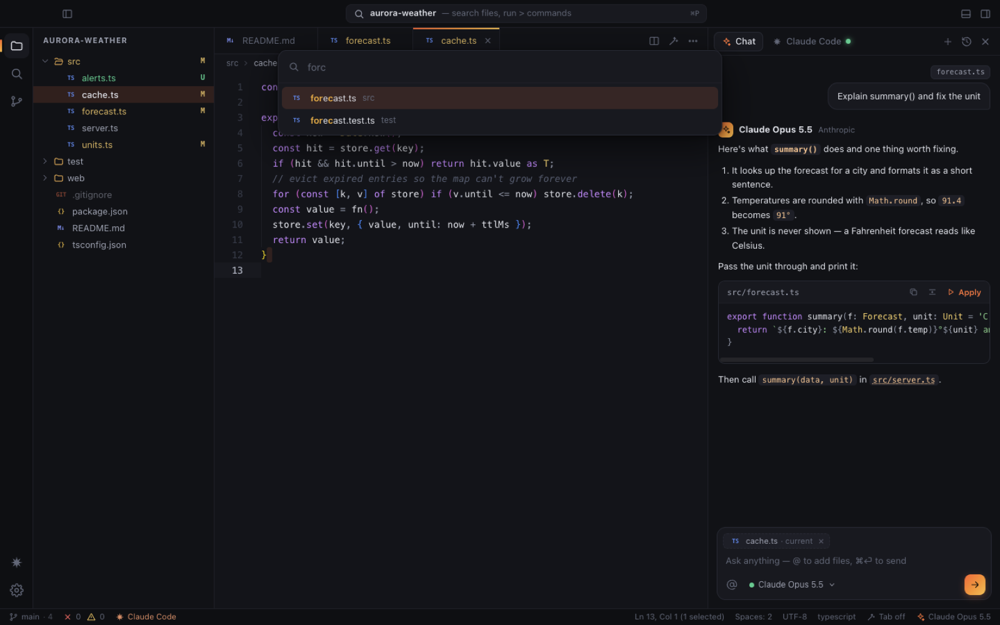
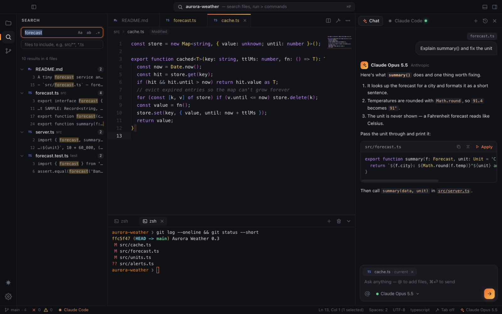
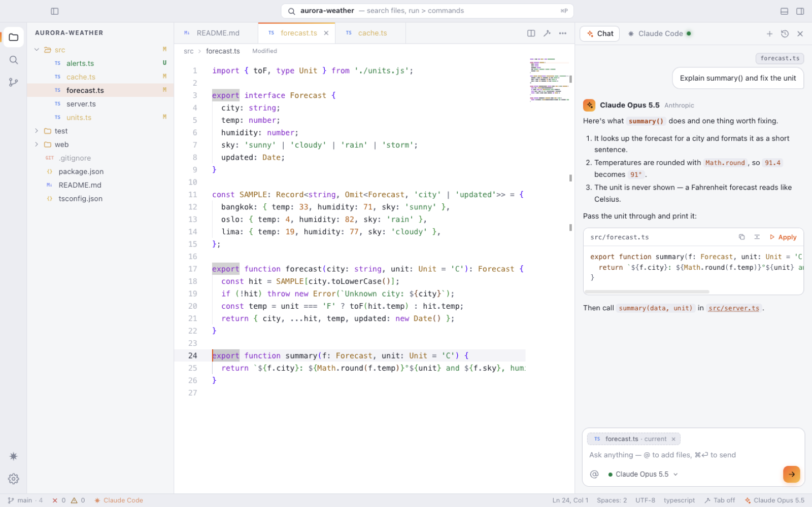
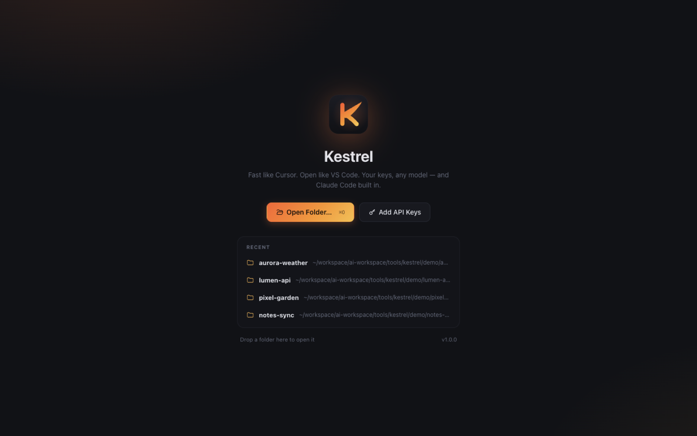
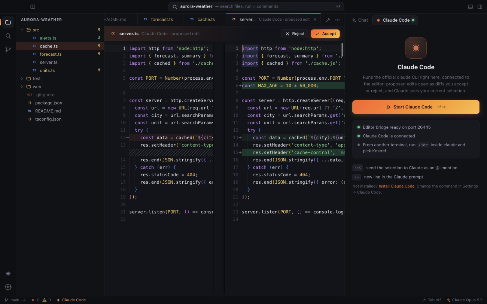
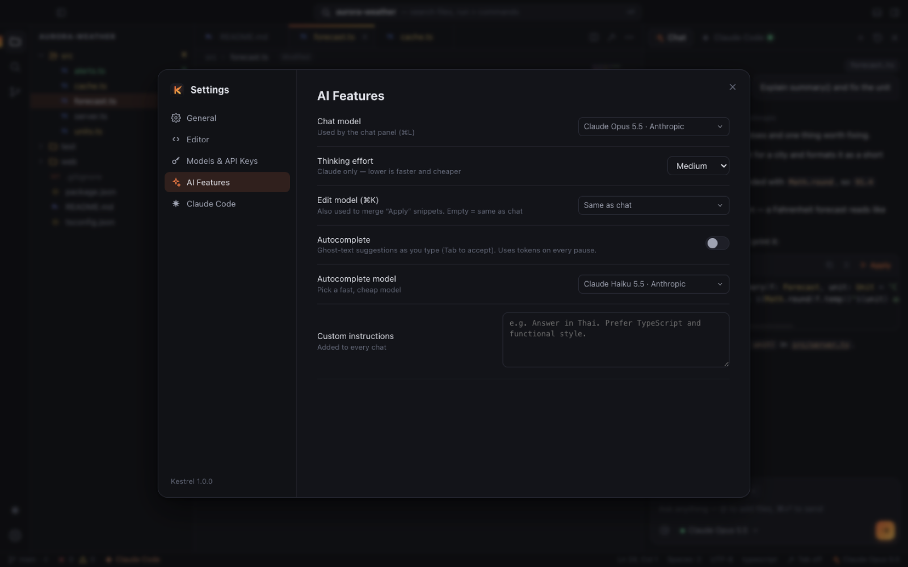

<div align="center">



# Kestrel

**A fast, beautiful AI code editor for macOS.**

It's as fast as Cursor and as open as VS Code. Bring your own API keys for any model, and use the real **Claude Code** built right in.


-007ACC)


[](LICENSE)

[Features](#-features) · [Claude Code](#-claude-code-built-in) · [Models & keys](#-models--api-keys) · [Install](#-install) · [Shortcuts](#%EF%B8%8F-keyboard-shortcuts) · [How it works](#-how-it-works) · [ภาษาไทย](#-ภาษาไทย)



</div>

---

## Why Kestrel?

**Cursor** is fast and polished, but it's a subscription product built around its own models and plans. **VS Code** runs everything, but its AI features revolve around one vendor. Kestrel keeps the parts that matter and leaves the lock-in out:

| | Cursor | VS Code | **Kestrel** |
|---|:---:|:---:|:---:|
| ⌘K edit-in-place, chat with Apply-as-diff | ✅ | partly | ✅ |
| Bring your own key for **any** provider | limited | limited | ✅ 10 providers |
| Real **Claude Code** with editor diffs & selection sharing | via extension | ✅ extension | ✅ **built in** |
| Local models (Ollama, LM Studio…) | – | ✅ | ✅ |
| No account, no subscription, no telemetry | – | ✅ | ✅ |
| Open source | – | ✅ | ✅ MIT |

- ⚡ **Fast.** It's built on Monaco, the same editor core as VS Code, with a thin vanilla-JS shell around it. There's no extension host to boot and no framework re-rendering behind your keystrokes.
- 🎨 **Beautiful.** The theme is warm and dark-first (light and system themes too), with a custom syntax palette, file badges, git colours, and a status bar that tells you what matters.
- 🔑 **Yours.** API keys are encrypted with the macOS Keychain and are only ever sent to the provider you picked. There's no account, analytics, or middleman server.

> [!NOTE]
> Kestrel is **not** a VS Code fork and does not run VS Code marketplace extensions. Building that means compiling all of VS Code (10 GB+ and hours of build time). Instead, Kestrel speaks the **Claude Code IDE protocol** natively. That is the one extension most people install an AI editor for, and here you get it without any extension at all.

## ✨ Features

### Chat with any model, apply code as a diff
Press **⌘L** to chat. The current file is attached automatically, and you can add more files with **@** or send a selection with **⇧⌘L**. Replies stream in as Markdown with syntax-highlighted code. Each code block has **Copy**, **Insert at cursor** and **Apply**. Apply opens a side-by-side diff against the target file, with unchanged regions folded away. If the model wrote only a partial snippet, Kestrel first merges it into the whole file with your edit model, the same way Cursor does.



### ⌘K: edit with AI, right where you are
Select some code, press **⌘K** and describe the change. The new code is written into the editor as one undoable edit. The old lines appear struck through in red above it, so you can **Accept (⌘↵)** or **Reject (Esc)**. With nothing selected, ⌘K generates code at the cursor.



### Tab autocomplete (optional)
Ghost-text completions come from any model you choose. A fast, cheap one is best, such as Claude Haiku 5.5, a Groq-hosted model, or a local Ollama model. It's off by default because it spends tokens every time you pause typing. Turn it on from the status bar or with **AI → Toggle Autocomplete**.

### A real editor
- Monaco with IntelliSense for TS/JS/JSON/CSS/HTML and syntax highlighting for 80+ languages. You also get multi-cursor, sticky scroll, bracket-pair colours, the minimap, find and replace, and Go to Symbol / Definition.
- **Tabs** with preview mode (single-click previews, double-click or editing pins), drag-to-reorder, dirty dots, and session restore per folder.
- **Explorer** with lazy folders, inline new file/folder/rename, drag-to-move, Move to Trash, and git status colours.
- **Find in files** with case, whole-word and regex toggles and include globs. It respects `.gitignore`.
- **Source control** shows changed files, and any of them can open as a diff against `HEAD`.
- **Integrated terminal** (xterm.js + a real PTY running your login shell). You can drag files into it to paste their paths.
- **⌘P** opens files, **⇧⌘P** runs commands, `:` goes to a line and `@` jumps to a symbol, all from one fuzzy palette.
- Image preview, external-change reload, auto save, format on save, and dark, light or system themes.

<table>
<tr>
<td width="50%"></td>
<td width="50%"></td>
</tr>
<tr>
<td width="50%"></td>
<td width="50%"></td>
</tr>
</table>

## ✳️ Claude Code, built in

Kestrel runs the **official `claude` CLI** in the right-hand pane (**⌘Esc**) and connects it to the editor through the same local protocol the official VS Code and JetBrains integrations use:

- **Edits arrive as diffs.** When Claude wants to change a file you get a diff tab. **Accept** lets Claude write it, and **Reject** tells Claude no. You can tweak the right-hand side before accepting.
- **Claude sees your selection.** Whatever you select is shared live, so "fix this" just works.
- **⌥⌘K** sends the selection (or the file) to Claude as an `@file#L10-20` mention.
- **Diagnostics.** Claude can read the errors and warnings the editor shows.
- **Using claude in another terminal?** Run `/ide` inside it and pick **Kestrel**.

If `claude` on your `PATH` is broken (for example, an npm install whose native binary never downloaded), Kestrel finds a working copy on its own. It looks in the native installer location, Homebrew, and any copy bundled with VS Code, Cursor or Windsurf.



## 🔑 Models & API keys

Open **Settings → Models & API Keys**, paste a key, and press **Fetch models** to load the provider's live model list.

| Provider | Notes |
|---|---|
| **Anthropic** | Claude Opus 5.5 (default), Sonnet 5.5, Haiku 5.5, Fable 5.2. Uses the official SDK, with effort control and server-side refusal fallback. |
| **OpenAI** | Any chat model your key can use |
| **Google Gemini** | Uses the Gemini streaming API |
| **OpenRouter** | Hundreds of models through one key |
| **Groq**, **DeepSeek**, **Mistral**, **xAI** | OpenAI-compatible endpoints |
| **Ollama** | Local, no key needed (`http://localhost:11434/v1`) |
| **OpenAI-compatible** | Any base URL, e.g. LM Studio, vLLM, LiteLLM or a company proxy |

You can pick different models for **chat**, **⌘K / Apply**, and **autocomplete**. You can also add your own instructions to every chat, for example "Answer in Thai".



## 📦 Install

Requirements: macOS 11+, Node.js 20+, and git. Claude Code is optional ([install it](https://docs.claude.com/en/docs/claude-code/setup)).

```bash
git clone https://github.com/pucksaeroi-beep/kestrel.git
cd kestrel
npm install
npm run install-app      # builds Kestrel.app and copies it to /Applications
```

The app is unsigned (no developer account needed). The first time, right-click **Kestrel.app → Open**.

To run it from source:

```bash
npm run dev          # Vite dev server + Electron with hot reload
npm start            # production build, then run
npm test             # unit tests (parsers, Markdown, fuzzy match, workspace sandbox, Claude Code bridge)
```

### Try it without spending tokens
```bash
npm run demo                      # creates demo/aurora-weather, a mock project
npm run mock-ai                   # fake Anthropic/OpenAI server on :8787 with canned replies
```
Then set the Anthropic base URL to `http://127.0.0.1:8787` in **Settings → Models**. Any key works with the mock.

## ⌨️ Keyboard shortcuts

| Keys | Action | | Keys | Action |
|---|---|---|---|---|
| **⌘P** | Go to file | | **⌘L** | AI chat |
| **⇧⌘P** | Command palette | | **⇧⌘L** | Add selection to chat |
| **⌘K** | Edit with AI | | **⌥⌘N** | New chat |
| **⌘Esc** | Launch Claude Code | | **⌥⌘K** | Send selection to Claude Code |
| **⌃`** / **⌘J** | Toggle terminal | | **⌘B** | Toggle sidebar |
| **⇧⌘F** | Find in files | | **⌥⌘B** | Toggle AI pane |
| **⌘S** / **⌥⌘S** | Save / Save all | | **⌘W** | Close tab |
| **⌃G** | Go to line | | **⇧⌘O** | Go to symbol |
| **F12** | Go to definition | | **⌘= / ⌘-** | Zoom |

## 🔧 How it works

```
┌────────────────────────── Renderer (sandboxed, no Node) ─────────────────────────┐
│  Monaco editor · tabs · explorer · search · palette · xterm.js · chat · ⌘K       │
└───────────────▲──────────────────────────────────────────────────────────────────┘
                │ contextBridge (window.ks): named calls only, no raw fs/shell
┌───────────────┴─────────────── Main process ────────────────────────────────────┐
│ workspace.cjs: file access confined to the open folder (path traversal refused)  │
│ ai.cjs:        Anthropic SDK + OpenAI/Gemini SSE streaming, keys in Keychain     │
│ ide.cjs:       Claude Code bridge: WebSocket MCP server on 127.0.0.1             │
│                + ~/.claude/ide/<port>.lock (0600, random auth token)             │
│ node-pty:      your login shell; CLAUDE_CODE_SSE_PORT set so claude auto-connects│
└──────────────────────────────────────────────────────────────────────────────────┘
```

- **Security.** The renderer runs with `sandbox`, `contextIsolation` and a strict CSP, and it never sees API keys. Every file path is resolved and checked against the workspace root. The Claude Code bridge listens only on localhost, requires the token from the lock file, and removes the lock file on quit.
- **Privacy.** Chat history is stored locally for each folder. Context (open file, selection, @-files) is sent only to the model you chose, and only when you send a message.
- **Small surface.** The runtime dependencies are `@anthropic-ai/sdk`, `ws` and `node-pty`. Monaco and xterm.js are bundled by Vite.

```
electron/   main.cjs · preload.cjs · workspace.cjs · ai.cjs · ide.cjs · sse.cjs
src/        main.js (layout, menus, boot) · state.js
  editor/   monaco.js (workers, themes) · editors.js (tabs, docs, diff)
  views/    explorer · search (+ source control) · terminal · palette · settings
  ai/       ai.js · chat.js · inline.js (⌘K + autocomplete) · claude.js (pane + IDE bridge)
  lib/      markdown.js · fuzzy.js · lang.js       ← pure, unit-tested
scripts/    demo-workspace.mjs · mock-ai.mjs · install-app.mjs
```

## 📄 License

[MIT](LICENSE) © 2026 pucksaeroi-beep

Kestrel is an independent project. It is not affiliated with Anthropic, Cursor or Microsoft. "Claude" and "Claude Code" are trademarks of Anthropic.

---

## 🇹🇭 ภาษาไทย

**Kestrel** คือโปรแกรมเขียนโค้ดพร้อม AI สำหรับ macOS ที่เร็วแบบ Cursor และเปิดกว้างแบบ VS Code ใช้ API key ของคุณเองได้ทุกค่าย และมี **Claude Code ตัวจริง** ติดมาให้ในตัว

- **แชตกับ AI (⌘L):** แนบไฟล์ที่เปิดอยู่ให้อัตโนมัติ ใช้ @ เพื่อเพิ่มไฟล์อื่น ทุกบล็อกโค้ดมีปุ่ม **Apply** ซึ่งเปิดหน้าเทียบ diff ให้ตรวจก่อนกด Accept
- **⌘K แก้โค้ดตรงจุด:** เลือกโค้ด พิมพ์สิ่งที่อยากแก้ แล้วดูบรรทัดเก่า (สีแดง) เทียบกับบรรทัดใหม่ (สีเขียว) จากนั้นกด ⌘↵ เพื่อรับ หรือ Esc เพื่อยกเลิก
- **Claude Code ในตัว (⌘Esc):** รัน `claude` CLI ตัวจริงที่แผงด้านขวา และเชื่อมกับ editor ด้วยโปรโตคอลเดียวกับ extension ของ VS Code เมื่อ Claude จะแก้ไฟล์จะขึ้นเป็น diff ให้กด Accept/Reject Claude เห็นโค้ดที่คุณเลือกอยู่ และ ⌥⌘K ใช้ส่งโค้ดที่เลือกไปเป็น @mention
- **API key 10 ค่าย:** Anthropic, OpenAI, Gemini, OpenRouter, Groq, DeepSeek, Mistral, xAI, Ollama (รันในเครื่อง) และ endpoint ใดก็ได้ที่ใช้รูปแบบเดียวกับ OpenAI key ถูกเข้ารหัสด้วย Keychain ของ macOS และไม่ส่งไปที่อื่นนอกจากค่ายที่คุณเลือก
- **ฟีเจอร์ editor ครบ:** Monaco (แกนเดียวกับ VS Code), แท็บ, ตัวจัดการไฟล์, ค้นหาทั้งโปรเจกต์, เทียบ git diff, เทอร์มินัล, ⌘P/⇧⌘P และธีมมืด/สว่าง

> ข้อจำกัด: Kestrel ไม่ได้ fork มาจาก VS Code จึงติดตั้ง extension จาก marketplace ไม่ได้ แต่รองรับ Claude Code แบบ native ในตัวแทน

**ติดตั้ง:** `npm install && npm run install-app` แล้วเปิด Kestrel จาก Launchpad (ครั้งแรกให้คลิกขวาแล้วเลือก Open)
